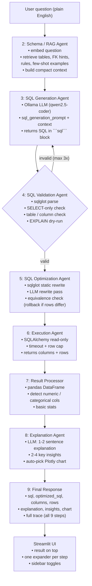

# architecture

## pipeline overview



## component map

| file | role |
|------|------|
| `config.py` | all settings (model, DB URL, paths, timeouts) |
| `core/llm.py` | OllamaBackend + HuggingFaceBackend, extract_sql |
| `core/prompts.py` | all prompt templates (shared with finetune) |
| `core/validator.py` | sqlglot parse + forbidden op + schema check |
| `core/pipeline.py` | orchestrator, trace, ties agents 2-9 together |
| `rag/indexer.py` | builds ChromaDB from tables / FK / rules / examples |
| `rag/retriever.py` | queries ChromaDB, builds context string |
| `agents/schema_agent.py` | step 2 |
| `agents/sql_agent.py` | step 3 |
| `agents/validator_agent.py` | step 4 |
| `agents/optimizer_agent.py` | step 5 |
| `agents/executor_agent.py` | step 6 |
| `agents/result_processor.py` | step 7 |
| `agents/explainer_agent.py` | step 8 |
| `app.py` | Streamlit UI |
| `db/create_db.py` | builds 12-table college.db (300 students) |
| `eval/run_eval.py` | eval on 100 Qs, 5 systems (A-E) |

## database schema (12 tables)

```
departments  ←─ students  ←─ enrollments  ←─ marks
                         ←─ attendance
                         ←─ fees
                         ←─ hostel_allotments ←─ hostels
                         ←─ club_members ←─ clubs ←─ faculty
departments  ←─ faculty
departments  ←─ courses  ←─ enrollments
```

## rag collections (ChromaDB)

| collection | documents | use |
|------------|-----------|-----|
| `tables` | 1 per table with schema + sample values | table retrieval |
| `fk_relationships` | 1 per FK with join hint text | join path hints |
| `rules` | 1 per business rule line | rule retrieval |
| `examples` | 1 per question→SQL pair | few-shot retrieval |
